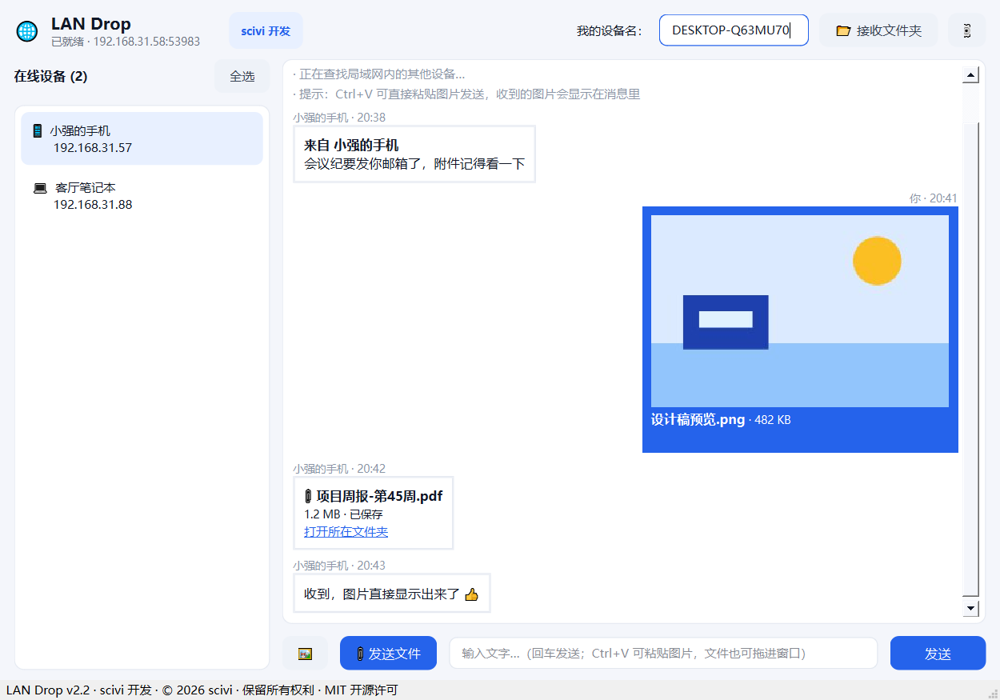
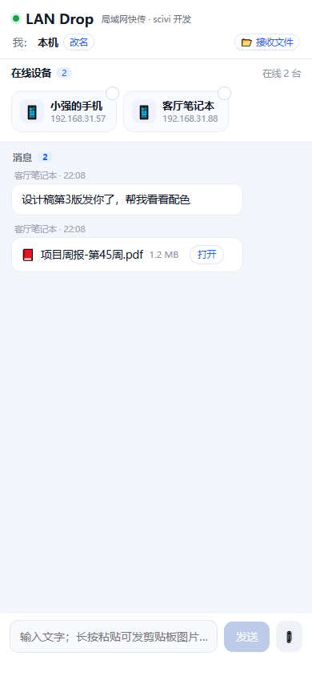

# LAN Drop · 局域网文件互传

> 同一 Wi-Fi 下，Windows 与 Android 之间秒传文件、文字和图片。无需服务器、无需账号、无需公网，数据不经过任何第三方。


**作者：scivi** · © 2026 scivi · 保留所有权利 · 基于 MIT 许可开源

<p align="center">
  <br>
  
</p>

## 特性

- **自动发现**：启动即在局域网内 UDP 广播，双方自动出现在对方设备列表里，无需输入 IP。
- **点对点直传**：TCP 直连传输，文件不经过中转，速度取决于路由器带宽。
- **IM 式交互**：左侧消息流、右侧在线设备，点一下设备卡片即可发送，像飞秋一样顺手。
- **图片即发即显**：对话框里 `Ctrl+V` 直接粘贴截图发送，对方收到的是带缩略图的气泡；也可以拖拽文件到窗口。
- **接收路径可改**：桌面端和安卓端都能自定义接收目录，安卓支持 SAF 目录授权。
- **大文件友好**：流式落盘，不做整文件内存缓冲。
- **零依赖部署**：桌面端提供单文件 `exe`，安卓端提供已签名 `apk`。

## 下载

到 [Releases](../../releases/latest) 页面下载最新版本：

| 平台 | 文件 | 说明 |
| --- | --- | --- |
| Windows 10/11 x64 | `LANDrop.exe` | 免安装单文件，双击运行 |
| Android 7.0+ | `LANDrop.apk` | 允许"安装未知来源应用"后安装 |

> 首次运行时 Windows 会弹出防火墙提示，请选择「允许访问」，否则对方无法发现本机。

不会用？请看 **[完整中文使用说明](使用说明.md)**（安装、收发文件、改接收目录、连不上的排查步骤都有图解说明）。

## 使用

1. 电脑和手机连接到**同一个** Wi-Fi / 局域网（手机不要开流量，也不要连访客网络）。
2. 两端都打开 LAN Drop。
3. 在设备列表里点选目标设备，输入文字或选择文件发送。
4. 接收方消息流中会出现对应气泡，点击「打开所在文件夹」即可定位文件。

安卓端在顶部可以查看和修改接收目录；桌面端通过右上角设置按钮修改。

## 从源码运行

### 桌面端

```bash
pip install PySide6
python desktop/app.py
```

### 打包成单文件 exe

```bash
pip install pyinstaller
cd desktop
pyinstaller LANDrop.spec
# 产物：desktop/dist/LANDrop.exe
```

### 安卓端

不依赖 Gradle / Android Studio，脚本直接调用 `aapt2 + javac + d8 + apksigner`：

```bash
cd android
./build_apk.sh          # 产物：android/dist/LANDrop.apk
```

脚本需要本地 `android/.tools/` 下存在 JDK 与 Android SDK（build-tools 34.0.0 / platform android-34），
首次构建会自动生成签名用的 `landrop.keystore`（该文件已被 `.gitignore` 排除）。

## 通信协议

两端共用一套极简协议，方便自行实现客户端。

**设备发现**：UDP 广播（含子网定向广播），端口 `24250`，定时重发心跳

```json
{ "app": "landrop", "name": "设备名", "id": "设备唯一ID", "os": "windows|android", "port": 随机高位端口 }
```

其中 `port` 是本机 HTTP 服务的实际监听端口（启动时由系统分配），对端据此直连。

**文件传输**：HTTP `POST /upload?from_id=&from_name=&name=<URL编码文件名>`，请求体为文件原始字节。

**文字消息**：同样走 `POST /upload`，`kind=text`，正文为 UTF-8 文本。

**图片消息**：在文字消息基础上附加 `image: true` 与 `thumb: "data:image/jpeg;base64,..."` 缩略图，接收端据此渲染图片气泡。
缩略图只用于预览，原图仍是独立文件传输。

## 目录结构

```
├── 使用说明.md         # 面向普通用户的完整图文使用手册
├── desktop/            # PySide6 桌面端
│   ├── core.py         # 发现 + 传输内核（无 UI 依赖，可单独复用）
│   ├── app.py          # 界面
│   ├── LANDrop.spec    # PyInstaller 配置
│   └── icon.ico
├── android/            # 原生 Android 客户端（WebView + Java 网络层）
│   ├── src/com/landrop/app/   # Net.java / MainActivity.java / Store.java ...
│   ├── assets/index.html      # 界面
│   ├── res/drawable/          # 图标
│   ├── AndroidManifest.xml
│   └── build_apk.sh
├── web/server.py       # 早期 Web 版本（浏览器访问，功能保留）
└── icon.png
```

## 常见问题

**对方一直不出现？**
确认在同一网段；检查 Windows 防火墙是否放行；部分路由器开启了「AP 隔离」会导致设备互不可见；VPN / 虚拟机网卡也可能抢走广播包。

**安卓收不到通知？**
安卓端为前台运行模式，请保持 App 在最近任务中，不要划掉。

**图片不显示？**
旧版本客户端只识别文字与文件，图片气泡需要两端均为 v2.2 及以上。

## 作者

**scivi** · GitHub [@scivi1989](https://github.com/scivi1989)

本项目的协议设计、桌面端（Python/PySide6）、Android 端（Java + WebView）及界面均由 scivi 独立开发。
欢迎提 Issue 和 PR；转载、二次分发请保留作者署名与版权声明。

## 许可

[MIT](LICENSE) © 2026 scivi
